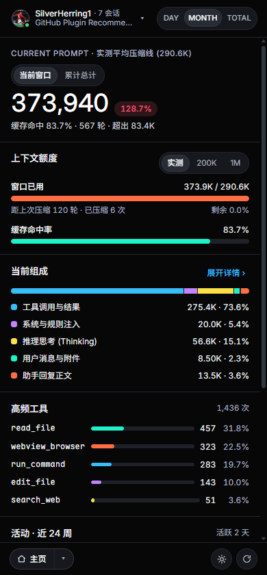
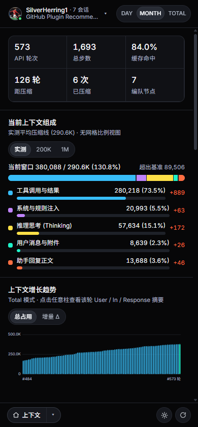
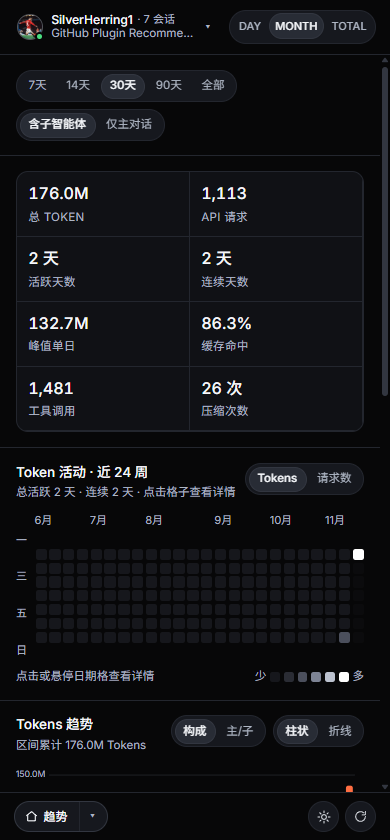
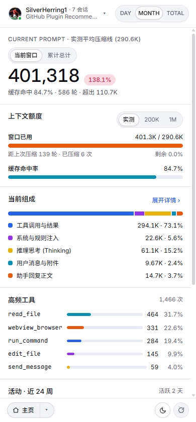
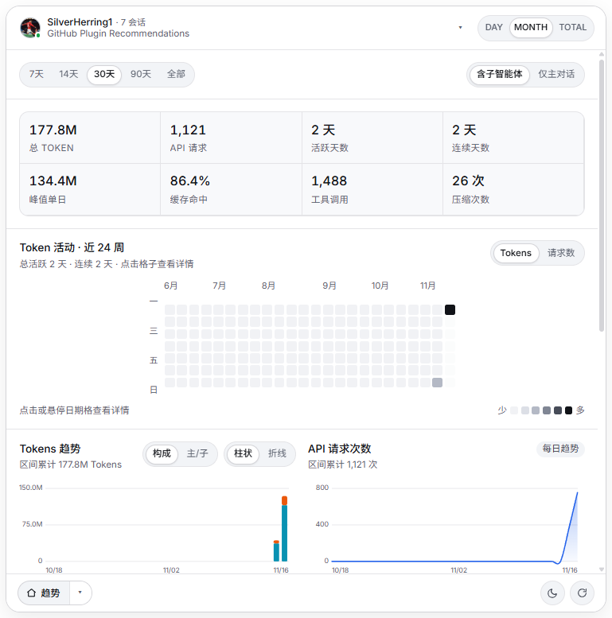

<div align="center">

# Context & Usage (`context-usage`)

**Antigravity IDE 侧边栏上下文窗口与 Token 用量监控插件**  
**Live Context Window & Token Telemetry Dashboard Plugin for Antigravity IDE**

[中文说明](#中文说明) · [English](#english) · [Screenshots / 效果预览](#screenshots--效果预览)

</div>

---

## Screenshots / 效果预览

<table>
  <tr>
    <td align="center"><b>Dark · Home / 深色主页</b></td>
    <td align="center"><b>Dark · Context / 上下文构成与轨迹</b></td>
    <td align="center"><b>Dark · Trends / 趋势与 24 周热力图</b></td>
    <td align="center"><b>Light · Home / 浅色纯白模式</b></td>
  </tr>
  <tr>
    <td></td>
    <td></td>
    <td></td>
    <td></td>
  </tr>
</table>

<details>
<summary>Wide Desktop Trends Preview / 宽屏双栏趋势图预览</summary>
<p align="center">
  
</p>
</details>

---

## 中文说明

### 核心功能

- **实时上下文监测（主页 / 上下文）**：直观展示当前 Prompt Token 占用率、缓存命中率、已压缩次数，以及 `实测压缩线` / `200K` / `1M` 多阈值额度进度条。
- **6 段式语义组成拆解（参考 `dsh-context`）**：按 **工具调用与结果 / 系统与规则注入 / 推理思考 (Thinking) / 用户消息与附件 / 助手回复正文 / 剩余缓冲** 细拆占比，无需繁杂网格即可一眼看清窗口消耗来源；配合可交互 `总占用 / 增量 Δ` 轮次折线柱状图与步级摘要。
- **用量趋势与 24 周活动热力图（趋势）**：顶部 `DAY` / `MONTH` / `TOTAL` 胶囊快速切换统计周期，内置深浅自适应单色 24 周活动热力图、API 请求折线图与每日 Token 构成图，支持过滤是否计入子智能体。
- **编队与高频工具分析（编队与工具）**：清晰呈现主对话与 Subagent 编队层级、高频工具调用次数排行及文件读写明细。
- **贴合 Antigravity 的视觉与双主题**：
  - 深色模式采用 Antigravity 原生 `#070708` 深炭底配高饱和荧光数据色与纯白热力方格；浅色模式采用纯净 `#ffffff` 底配高对比宝石色与灰度墨黑热力方格，支持右上/底部按钮一键手动切换并持久化至 `localStorage`。
  - 内置离线开源 `InterVariable` 与 `Maple Mono`（`woff2`）字体，数字自带 `tabular-nums` 等宽对齐，免外网 CDN 即可稳定清晰渲染。
- **纯本地只读统计**：所有数据仅在本地以只读方式解析 `~/.gemini/<app>/brain/` 会话记录，不上传任何对话内容。

### 安装到 Antigravity

将本仓库整个目录复制到 Antigravity 插件目录，并在 Plugins 管理器中启用即可：

- **Windows**：`C:\Users\<用户名>\.gemini\config\plugins\context-usage`
- **macOS / Linux**：`~/.gemini/config/plugins/context-usage`

### 本地独立预览（无需宿主）

环境仅需 Node.js 18+（无第三方 npm 运行依赖）：

```powershell
node sidecars/usage_panel/main.mjs --standalone --port 18421
```

然后在浏览器访问 `http://127.0.0.1:18421/`；如需固定高亮某个活跃会话，可传入环境变量 `ANTIGRAVITY_CONVERSATION_ID=<conversation-uuid>`。

---

## English

### Features

- **Live Context & Quota Inspector (`Home` / `Context`)**: Tracks real-time prompt occupancy, cache hit ratio, compaction counts, and adaptive quota meters (`Observed` / `200K` / `1M`).
- **6-Segment Semantic Composition**: Breaks context consumption cleanly into **Tool Calls & Results**, **System & Rules**, **Thinking**, **User Prompts**, **Assistant Responses**, and **Free Buffer**, paired with an interactive `Total / Delta` per-turn trajectory chart and step brief.
- **Usage Trends & 24-Week Heatmap (`Trends`)**: Quick `DAY` / `MONTH` / `TOTAL` period glider, monochrome 24-week activity heatmap, daily API call area chart, stacked token bars, and subagent scope filtering.
- **Fleet & Tool Breakdown (`Fleet & Tools`)**: Subagent tree view, top tool invocation bars, and file read/write activity list.
- **Dual High-Contrast Antigravity Themes & Bundled Webfonts**: Native `#070708` dark obsidian with luminous fluorescent data accents + white monochrome heatmap, alongside crisp `#ffffff` light mode with grayscale ink heatmap and persistent theme toggle (`localStorage`). Ships with offline `InterVariable.woff2` and `MapleMono-Regular.woff2` webfonts (zero CDN dependency).
- **100% Local & Read-Only**: Parses `~/.gemini/<app>/brain/` session transcripts locally in read-only mode. Nothing leaves your machine.

### Installation

Copy this plugin directory to your Antigravity plugins folder and enable it in the Plugins Manager:

- **Windows**: `C:\Users\<username>\.gemini\config\plugins\context-usage`
- **macOS / Linux**: `~/.gemini/config/plugins/context-usage`

### Standalone Local Preview

Requires Node.js 18+ (zero external npm dependencies):

```bash
node sidecars/usage_panel/main.mjs --standalone --port 18421
```

Open `http://127.0.0.1:18421/` in your browser. Optionally set `ANTIGRAVITY_CONVERSATION_ID=<conversation-uuid>` to pin an active conversation.

---

## Directory Structure / 目录结构

```text
context-usage/
├── plugin.json
├── README.md
├── assets/
│   └── logo.svg
├── docs/
│   └── screenshots/
│       ├── dark-home.png
│       ├── dark-context.png
│       ├── dark-trends.png
│       ├── light-home.png
│       └── light-trends.png
└── sidecars/
    └── usage_panel/
        ├── package.json
        ├── sidecar.json
        ├── main.mjs
        ├── lib/
        │   └── usage.mjs
        └── public/
            ├── index.html
            ├── styles.css
            ├── app.js
            ├── avatar.jpg
            └── fonts/
                ├── InterVariable.woff2
                └── MapleMono-Regular.woff2
```
