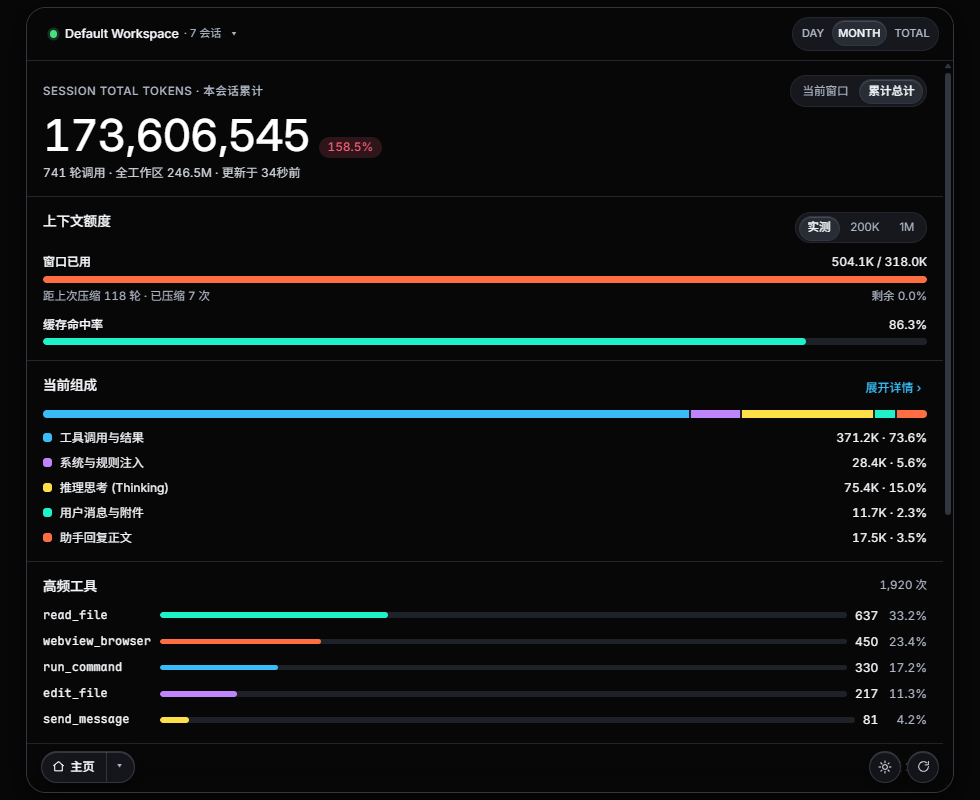
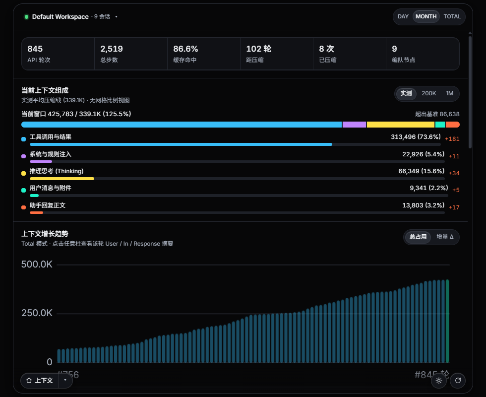
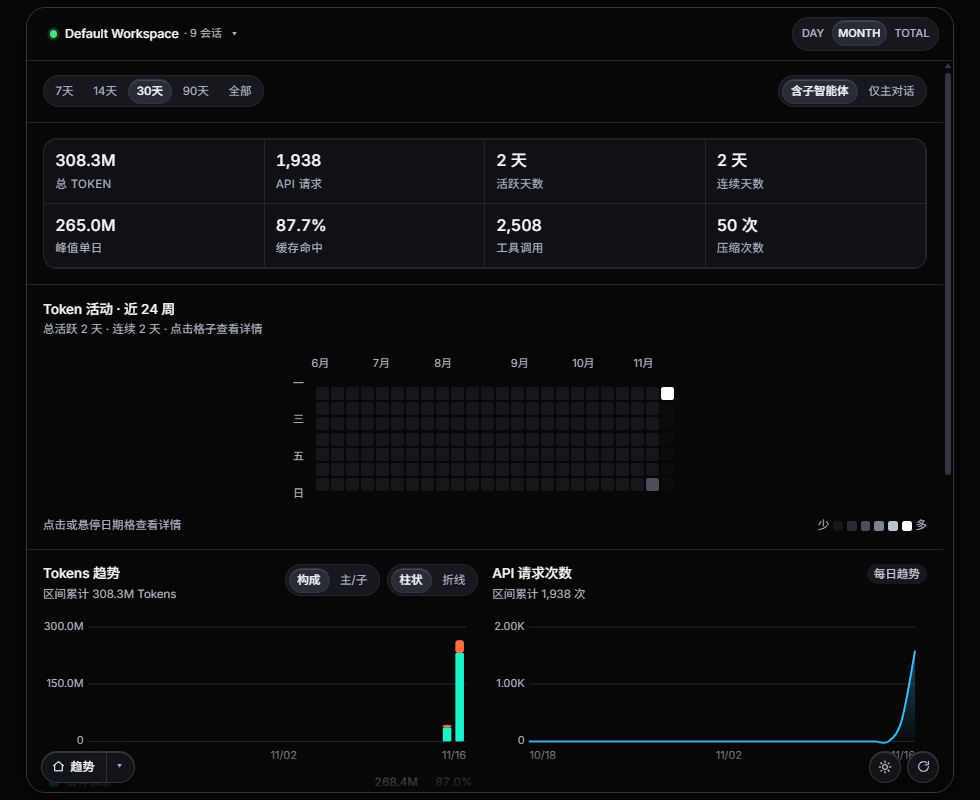
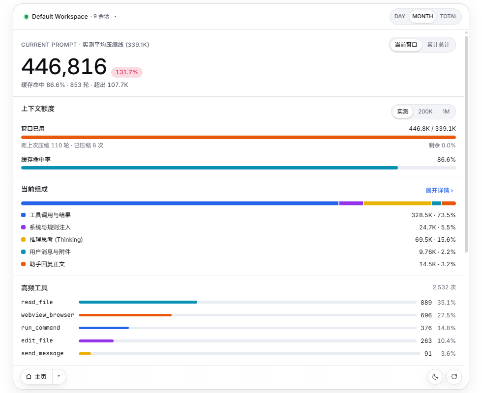
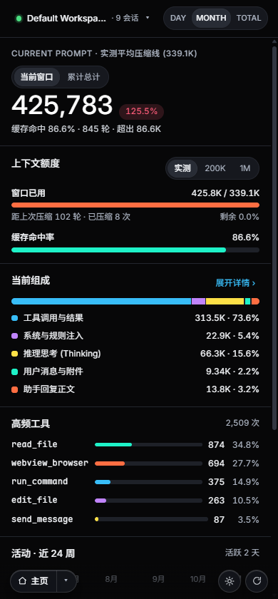
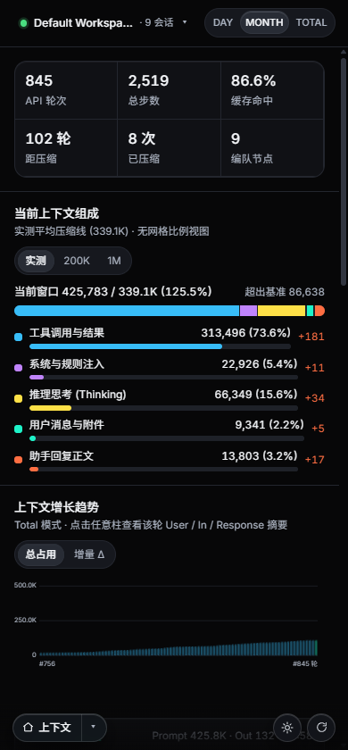
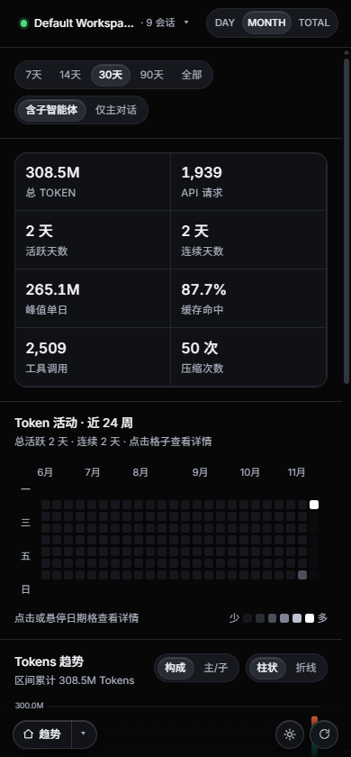
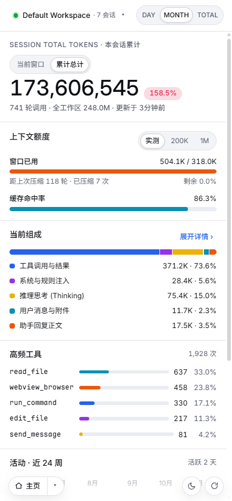

<div align="center">

# Context & Usage (`context-usage`)

**Antigravity IDE 侧边栏上下文窗口与 Token 用量监控插件**  
**Live Context Window & Token Telemetry Dashboard Plugin for Antigravity IDE**

[中文说明](#中文说明) · [English](#english) · [Screenshots / 效果预览](#screenshots--效果预览)

</div>

---

## Screenshots / 效果预览

<!-- Screenshots are hosted on the orphan 'assets' branch so 'main' stays clean without screenshot binaries. -->

### Wide Desktop / 宽屏视图

<p align="center">
  <b>Dark · Home / 深色主页</b><br/>
  
</p>

<p align="center">
  <b>Dark · Context / 上下文构成与轨迹</b><br/>
  
</p>

<p align="center">
  <b>Dark · Trends / 趋势与 24 周热力图</b><br/>
  
</p>

<p align="center">
  <b>Light · Home / 浅色纯白模式</b><br/>
  
</p>

### Narrow Sidecar / 窄屏侧边栏

<table width="100%">
  <tr>
    <th width="25%" align="center">Dark · Home</th>
    <th width="25%" align="center">Dark · Context</th>
    <th width="25%" align="center">Dark · Trends</th>
    <th width="25%" align="center">Light · Home</th>
  </tr>
  <tr>
    <td width="25%" align="center"></td>
    <td width="25%" align="center"></td>
    <td width="25%" align="center"></td>
    <td width="25%" align="center"></td>
  </tr>
</table>

---

## 中文说明

### 核心功能

- **极简顶栏与实时监测（主页 / 上下文）**：顶栏仅保留实时状态绿点、当前会话名称与多会话下拉切换器，右侧配备 `DAY` / `MONTH` / `TOTAL` 滑动切换胶囊；主视图直观呈现当前 Prompt Token 占用率、缓存命中率、已压缩次数，以及 `实测压缩线` / `200K` / `1M` 多阈值额度条。
- **6 段式语义组成拆解**：按 **工具调用与结果 / 系统与规则注入 / 推理思考 (Thinking) / 用户消息与附件 / 助手回复正文 / 剩余缓冲** 细拆占比，无需繁杂网格即可看清窗口消耗来源；配合带平滑过渡动画的 `总占用 / 增量 Δ` 轮次柱状图、`✂` 压缩标记线与步级摘要。
- **用量趋势与 24 周活动热力图（趋势）**：内置深浅自适应单色 24 周活动热力图、API 请求折线图与每日 Token 构成柱状/折线切换视图，支持按 `7天 / 14天 / 30天 / 90天 / 全部` 及是否计入子智能体过滤。
- **编队与高频工具分析（编队与工具）**：清晰呈现主对话与 Subagent 编队层级、高频工具调用排行及文件读写明细。
- **贴合 Antigravity 的双主题与离线字体**：
  - 深色模式采用 `#070708` 纯黑炭底配高对比荧光数据色与纯白单色热力方格；浅色模式采用纯净 `#ffffff` 底配高饱和数据色与灰度墨黑热力方格，支持底部按钮一键切换主题并持久化至 `localStorage`。
  - 内置开源离线 `InterVariable` 与 `Maple Mono`（`woff2`）字体，数字默认 `tabular-nums` 等宽对齐，零外网 CDN 依赖。
- **纯本地只读统计**：所有数据仅在本地以只读方式解析 `~/.gemini/<app>/brain/` 会话记录，不上传任何对话内容。

### 安装到 Antigravity

只需复制插件运行所需的核心文件（`plugin.json`、`assets/`、`sidecars/`）到 Antigravity 插件目录，无需复制 `README.md`：

- **Windows（PowerShell）**

```powershell
$dest = "$env:USERPROFILE\.gemini\config\plugins\context-usage"
New-Item -ItemType Directory -Force -Path $dest | Out-Null
Copy-Item plugin.json, assets, sidecars -Destination $dest -Recurse -Force
```

- **macOS / Linux**

```bash
DEST="$HOME/.gemini/config/plugins/context-usage"
mkdir -p "$DEST"
cp -R plugin.json assets sidecars "$DEST/"
```

复制完成后，在 Antigravity 的 **Plugins** 管理器中启用 `Context & Usage` 即可。

### 本地独立预览（无需宿主）

环境仅需 Node.js 18+（零第三方 npm 运行依赖）：

```bash
node sidecars/usage_panel/main.mjs --standalone --port 18421
```

然后在浏览器访问 `http://127.0.0.1:18421/`；如需固定高亮某个活跃会话，可设置环境变量 `ANTIGRAVITY_CONVERSATION_ID=<conversation-uuid>`。

---

## English

### Features

- **Minimal Session Header & Live Context Inspector (`Home` / `Context`)**: Clean top bar with live status dot, active conversation selector (zero personal avatar/username clutter), and `DAY` / `MONTH` / `TOTAL` period switcher; tracks prompt occupancy, cache hit ratio, compaction counts, and adaptive quota meters (`Observed` / `200K` / `1M`).
- **6-Segment Semantic Composition**: Breaks context usage into **Tool Calls & Results**, **System & Rules**, **Thinking**, **User Prompts**, **Assistant Responses**, and **Free Buffer**, paired with smoothly animated `Total / Delta` per-turn bar charts, `✂` compaction markers, and interactive step briefs.
- **Usage Trends & 24-Week Heatmap (`Trends`)**: Adaptive monochrome 24-week activity heatmap, animated API call area chart, stacked/line daily token charts, date range filters (`7d`–`All`), and main-vs-subagent scope toggling.
- **Fleet & Tool Breakdown (`Fleet & Tools`)**: Subagent hierarchy inspection, top tool invocation ranking bars, and file read/write activity logs.
- **Dual High-Contrast Antigravity Themes & Bundled Webfonts**: Native `#070708` obsidian dark mode with crisp luminous accents + monochrome white heatmap alongside `#ffffff` pure light mode with ink-gray heatmap and persistent toggle (`localStorage`). Bundles offline `InterVariable.woff2` and `MapleMono-Regular.woff2` fonts with `tabular-nums` alignment.
- **100% Local & Read-Only**: Parses `~/.gemini/<app>/brain/` transcripts locally in read-only mode. No conversation data ever leaves your machine.

### Installation

Copy only the runtime plugin files (`plugin.json`, `assets/`, `sidecars/`) into your Antigravity plugins folder (`README.md` is not needed at runtime):

- **Windows (PowerShell)**

```powershell
$dest = "$env:USERPROFILE\.gemini\config\plugins\context-usage"
New-Item -ItemType Directory -Force -Path $dest | Out-Null
Copy-Item plugin.json, assets, sidecars -Destination $dest -Recurse -Force
```

- **macOS / Linux**

```bash
DEST="$HOME/.gemini/config/plugins/context-usage"
mkdir -p "$DEST"
cp -R plugin.json assets sidecars "$DEST/"
```

Then enable `Context & Usage` in the Antigravity Plugins Manager.

### Standalone Local Preview

Requires Node.js 18+ (zero external npm dependencies):

```bash
node sidecars/usage_panel/main.mjs --standalone --port 18421
```

Open `http://127.0.0.1:18421/` in your browser. Optionally set `ANTIGRAVITY_CONVERSATION_ID=<conversation-uuid>` to pin a specific session.

---

## Directory Structure / 目录结构

```text
context-usage/
├── plugin.json
├── README.md
├── assets/
│   └── logo.svg
└── sidecars/
    └── usage_panel/
        ├── package.json
        ├── sidecar.json
        ├── main.mjs
        ├── lib/
        │   └── usage.mjs
        └── public/
            ├── index.html
            ├── styles.css
            ├── app.js
            └── fonts/
                ├── InterVariable.woff2
                └── MapleMono-Regular.woff2
```
